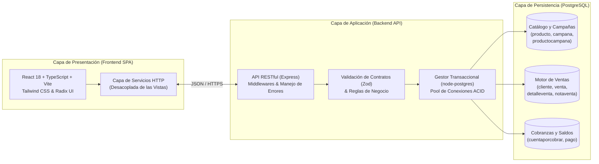

# Beauty Products — Gestión Comercial y Cobranzas por Campañas


Plataforma web **Full-Stack** diseñada para sistematizar el ciclo operativo de negocios de **venta directa por campañas mensuales**, integrando en un único flujo la administración de catálogos temporales, cartera de clientes, emisión de notas de venta y control transaccional de cuentas por cobrar.

---

## Problema a Mitigar

En la comercialización de productos de belleza por catálogo o campañas periódicas, la gestión manual mediante hojas de cálculo u herramientas genéricas de inventario suele presentar tres problemas críticos que este sistema resuelve de raíz:

1. **Variabilidad temporal de precios e historial corrupto:** Un mismo producto cambia de precio promocional y disponibilidad entre una campaña mensual y otra. Si se actualiza el precio directamente sobre una tabla maestra de productos, se altera o pierde la trazabilidad histórica de ventas de meses anteriores.
2. **Descontrol de riesgo crediticio y morosidad:** Gran parte de las ventas en este sector se realiza al crédito con pagos fraccionados (*abonos*). Sin un control automatizado de límites de endeudamiento por cliente y fechas de vencimiento, aumenta el riesgo de sobreendeudamiento y pérdida de liquidez.
3. **Inconsistencia entre pedidos, notas de venta y saldos:** Registrar una venta, emitir su comprobante y actualizar el estado de cuenta del cliente como pasos manuales separados genera descuadres financieros entre lo vendido, lo cobrado y lo pendiente por cobrar.

---

## Metodologías y Principios de Ingeniería Aplicados

### 1. Modelado de Dominio y Separación de Responsabilidades (Enfoque RUP)
El diseño de datos e interfaces sigue un modelo conceptual inspirado en **RUP (Rational Unified Process)**, desacoplando claramente tres niveles de entidades:
* **Entidades Maestras (`Producto`, `Cliente`, `Campania`):** Definen la identidad invariante del negocio. El producto maestro no almacena precio.
* **Entidades Asociativas de Vigencia (`ProductoCampania`):** Vinculan un producto maestro con una campaña específica, encapsulando su precio y disponibilidad para ese periodo sin afectar otras campañas.
* **Entidades Transaccionales y Financieras (`Venta`, `DetalleVenta`, `NotaVenta`, `CuentaPorCobrar`, `Pago`):** Al confirmar una venta, el precio vigente se congela en `DetalleVenta` como histórico inmutable.

### 2. Integridad Transaccional ACID en Base de Datos
Las operaciones críticas de negocio (registro de ventas y amortización de pagos) se ejecutan dentro de bloques transaccionales explícitos (`BEGIN` / `COMMIT` / `ROLLBACK`) sobre **PostgreSQL**:
* **Flujo de Venta:** Valida el tope de crédito acumulado del cliente, inserta el encabezado y detalle de la venta, genera la **Nota de Venta** correlativa y, según la modalidad, registra el desembolso inmediato (*Contado*) o apertura una **Cuenta por Cobrar** con plazo de vencimiento (*Crédito*). Si cualquier validación falla, toda la operación se revierte atómicamente.
* **Flujo de Cobranza:** Verifica que el abono no exceda la deuda vigente, inserta el pago, descuenta el saldo pendiente y transiciona automáticamente el estado de la cuenta de `VIGENTE` a `CANCELADA` al saldarse la totalidad.

### 3. Contratos Tipados de Extremo a Extremo
* **Validación en Runtime (Zod):** Cada endpoint de la API valida la estructura y restricciones semánticas de los payloads entrantes antes de tocar la capa de datos.
* **Tipado Estático (TypeScript):** Modelos de dominio compartidos conceptualmente entre el cliente SPA y los transformadores (*mappers*) del backend para evitar discrepancias entre el esquema relacional y la vista.

---

## Arquitectura del Sistema

El proyecto sigue una **arquitectura cliente-servidor desacoplada en tres capas**, preparada tanto para ejecución local como para despliegue distribuido en la nube (**Vercel** para el cliente SPA, **Render** para la API REST y **Supabase** para PostgreSQL):



---

## Stack Tecnológico

| Capa | Tecnologías | Rol en el Proyecto |
| :--- | :--- | :--- |
| **Frontend** | React 18, TypeScript, Vite, React Router DOM | Construcción de la Single Page Application (SPA), navegación declarativa y gestión de estado asíncrono mediante hooks personalizados (`useAsync`, `usePagination`). |
| **Interfaz de Usuario** | Tailwind CSS, Radix UI, Lucide React, Sonner | Sistema de diseño accesible basado en primitivas composables, tablas con filtros multicriterio, diálogos modales y notificaciones en tiempo real. |
| **Backend** | Node.js (ESM), Express, TypeScript | Exposición de servicios RESTful, validación de reglas de negocio, control de errores HTTP centralizado y configuración de seguridad CORS. |
| **Datos y Validación** | PostgreSQL, `pg` (node-postgres), Zod | Persistencia relacional, ejecución de consultas parametrizadas contra inyección SQL, control transaccional y validación de esquemas. |
| **Infraestructura Cloud** | Vercel · Render · Supabase | Despliegue continuo desacoplado de frontend, API y base de datos gestionada en la nube. |

---

## Módulos Principales

* **Dashboard Ejecutivo:** Consolidación de indicadores financieros clave (total vendido, total cobrado, saldo por cobrar y clientes con deuda activa), acceso rápido a las últimas transacciones y monitoreo de las cuentas con mayor exposición.
* **Catálogo Maestro y Campañas:** Creación de periodos comerciales mensuales, activación exclusiva de campaña en curso y asignación dinámica de precios y disponibilidad por producto.
* **Directorio y Perfil Crediticio de Clientes:** Gestión de clientes con validación de documento de identidad, filtros por situación de deuda e historial unificado de compras y abonos por persona.
* **Motor de Ventas en Dos Pasos:** Interfaz de punto de venta con selección de productos disponibles en la campaña activa, cálculo de carrito en tiempo real, verificación automática de límite de crédito y emisión de nota de venta.
* **Gestión de Cobranzas y Cuentas por Cobrar:** Control de saldos pendientes clasificados por estado de vencimiento (*Al día*, *Por vencer*, *Vencida*) y registro de pagos parciales o totales con trazabilidad por método de pago.

---

## Estructura del Repositorio

```text
beauty-products-app/
├── backend/                  # API RESTful en Node.js + Express + TypeScript
│   ├── src/
│   │   ├── config/           # Validación de variables de entorno y configuración
│   │   ├── db/               # Pool de conexiones PostgreSQL y wrapper de transacciones
│   │   ├── routes/           # Controladores y rutas por dominio de negocio
│   │   ├── utils/            # Manejadores asíncronos y excepciones HTTP tipadas
│   │   ├── app.ts            # Configuración de Express y middlewares globales
│   │   ├── mappers.ts        # Adaptadores entre el esquema relacional y el modelo de dominio
│   │   └── server.ts         # Punto de entrada del servidor
│   └── .env.example          # Plantilla de variables de entorno del backend
├── frontend/                 # Aplicación cliente SPA en React + TypeScript + Vite
│   ├── src/
│   │   ├── components/       # Sistema de diseño UI, layouts y componentes transversales
│   │   ├── features/         # Formularios y lógica interactiva modularizada por dominio
│   │   ├── hooks/            # Hooks reutilizables de carga asíncrona y paginación
│   │   ├── lib/              # Utilidades de formato monetario, fechas y periodos
│   │   ├── routes/           # Vistas principales de la aplicación
│   │   ├── services/         # Cliente HTTP y servicios de comunicación con la API
│   │   └── types/            # Contratos e interfaces del modelo de dominio
│   └── .env.example          # Plantilla de variables de entorno del frontend
└── README.md                 # Documentación general del proyecto
```

---

## Puesta en Marcha

1. **Clonar el repositorio:**
   ```bash
   git clone https://github.com/AnderAD21/beauty-products-app.git
   cd beauty-products-app
   ```

2. **Configurar variables de entorno:**
   Copia el archivo `.env.example` a `.env` tanto en `backend/` como en `frontend/`, y rellena las credenciales necesarias en dichos archivos según tu entorno de base de datos PostgreSQL y la URL de conexión de la API.

3. **Instalar dependencias e iniciar los servicios:**
   * **Backend:**
     ```bash
     cd backend
     npm install
     npm run dev
     ```
   * **Frontend:**
     ```bash
     cd frontend
     npm install
     npm run dev
     ```

---

## Autor

**Anderson Brayan Aranda Delgado** (`@AnderAD21`)  
Ingeniería Informática — Universidad Nacional de Trujillo (UNT, Perú)
